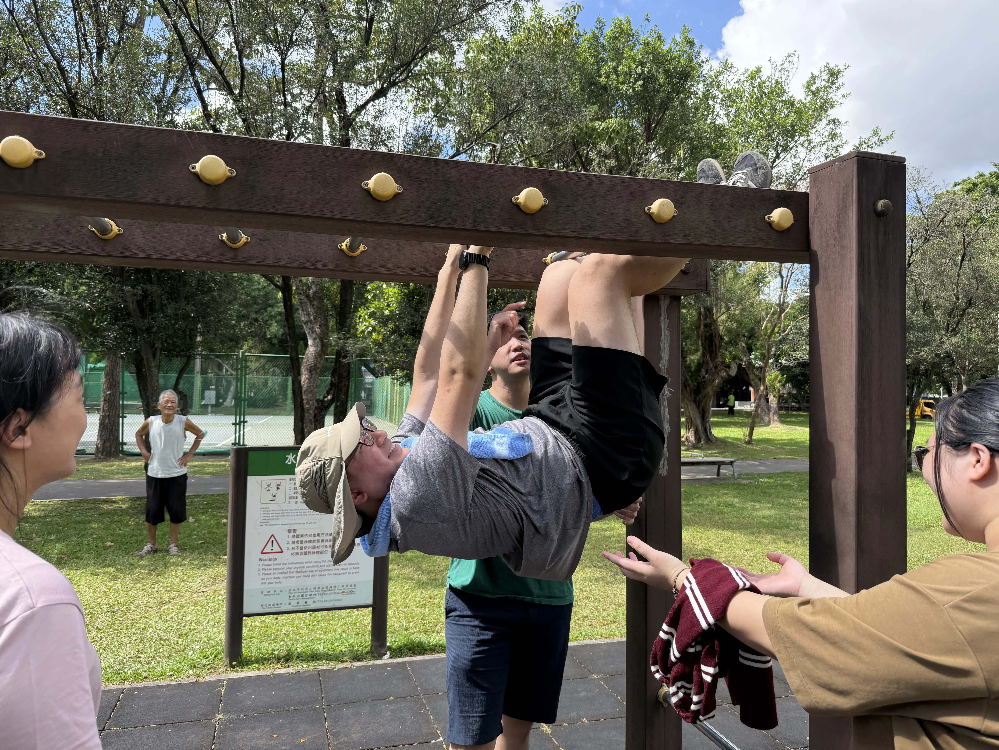
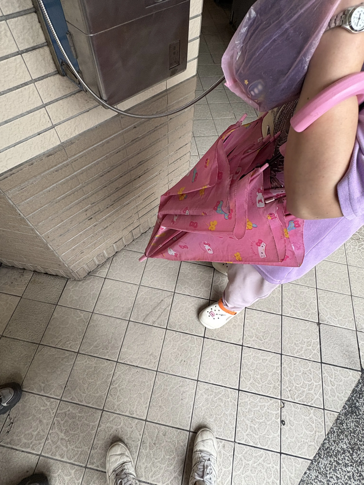

這次有幸回到向陽進行兩週教育訓練，感覺像是自己在實務現場待了一下又回來重新學習，而且站在受訓者的角度就可以好好學習跟發問，度過了很充實的時光。(另外還體驗抱石與越野跑工作坊)

我覺得，在向陽實習的經驗對我幫助很多，實際上在跟會員會談、帶團體動力、就業輔導、團隊合作都讓我至少有基本的概念該如何操作。

---
####  一、工作日是為了會所運作，質地仍然是人

搭著一年多以來的經驗，回頭到向陽來看，會發現平常自己的盲點，好像經常埋頭在做工作日，當會員少來的時候，就更焦慮於工作日沒有人做的問題。可是這其實忽略了原本的目的：工作日為了會所運作，最根本的質地仍然是人為主體。

在思考行動計劃的時候看到很多可能性，但要拉到督導的層次我才比較能看到所謂的軸線和圖像。如果只用部門去想，好像就被框架住，經過這次教育訓練才想得比較多元。

---
#### 二、幫準則除魅，不能訓練？

我覺得在會所工作最容易出現的大盲點就是會所準則，每個人對於準則有不一樣的詮釋，踩在不同的位置，中間甚至受到語言和文化的隔閡，這大大影響了每間會所實務面的操作。

有時，為了追求一點心安的感覺，可能有人把準則當作依靠，可是寫得那麼鬆散的準則真的可以做為依靠嗎？我們參考準則到什麼程度？這是需要做決定踩的位置，特別是有關就業訓練這塊。

不知道從什麼時候開始，印象中有人就拿準則19條強調工作日不能做訓練，讓訓練這件事在會所變得像禁忌一般，間接導致很多想找工作的會員就不來會所。可是很奇怪的是準則23條又說要提供就業計畫，這種矛盾好少聽到主張不能訓練的人如何解釋，而且準則每次都一條一條讀，片面理解跟個人詮釋居多，只有大概模糊的圖像，這表示，單靠根本不足以成為運作的依靠。

---
19. 設計會所的工作時，應以協助會員重拾自我價值、決心和信心為原則，並非為了進行特定職業的訓練。

23. 會所提供自設的支持性及一般性就業計畫來幫助會員就業，並讓他們的就業情況得以持續及改善。此外，作為會所支持性就業獨到的特色，會所亦與在職會員和雇主保持聯繫。會員跟職員一起決定所需支持的種類、次數及地點。

我覺得準則的某種理想性對照現實中會員的生存需要，有時候會看到很矛盾或諷刺的地方，例如貧窮的會員該如何支持他？住在康家的會員該如何支持他？明明就需要工作卻為何不訓練他？這背後受到非常多因素影響。想到這邊就會覺得，即便累積經驗也還是很薄弱。

但總之，閱讀準則、試著理解準則，最後幫準則除魅，我覺得是至關重要的。我相信準則的條文絕非可以成為工作者堅實的依靠，他頂多只是大略講了一些會所精神罷了，有太多空間都是要靠自己摸索跟累積經驗。我想這是基於這原因，向陽才長成現在這樣，不迴避談訓練。對我來說，聽到不迴避談訓練，好像才讓自己比較放心，雖然以前就知道，可是一起讀準則時就是會被帶著走。

---
#### 三、看見敏感的自己，成為一個過道

在向陽教育訓練的期間，發現自己很多問題想問，還被揪出常常說怎麼辦哈哈，我想我是發自內心想知道，關於會所的工作很難覺得自己沒有問題。我覺得這狀態也代表自己很放鬆、能夠做自己，有很多提問、反應、碎碎念。對我來說教育訓練真的很充實，問問題獲得解答的感覺很滿足。

事後覺得，原來自己的敏感還是很明顯，一個念頭會接連出現好幾個念頭。雖然已經很少主動意識到這點，但一直都把這特質當作自己的優勢。

回到情緒的議題，可以感受到很多、回饋很多、同時也要消化很多，有時候覺得好累哦。不過，這似乎是自己舒適的狀態，所以常常輸出很多東西。

﹒
重新檢視自己情緒起伏的外放、收斂，太放鬆時會變得很外放。但我覺得其實自己可以有意識的調整自己狀態，不是沒有學過，就如《慢讀漫談 》說的「聽之以氣」，或是越野跑工作坊大千說的雅樂的內觀狀態。那並非一種抽離，而是「凝視與穿越」。

另外，回到會所的就業輔導，其實早就覺得會員會受到自己情緒影響，但不知道影響這麼大，或是說每次我始終沒辦法「沉住氣」。但這次教育訓練回來，就有很明顯的發現，工作者的情緒起伏對會員有非常巨大的影響。

 ﹒
 如同最近在學游泳的體悟，情緒如水、如河流，若太用力反而不走水，智慧在於怎麼減少阻力，增加浮力與走水的感覺，即能順勢而走。魏明毅老師說，要成為一個過道，這是同樣的道理。

然後，對於會員的死亡，自己的情緒起伏，好像格外淡定或是抽離感，其實在動靜之間擺盪，我感覺那最終的狀態始終是一種動態平衡。

﹒
最後，這次認識一些新的夥伴，有不同的火花。以及很高興自己三年前還有被向陽的會員記得，關係得以延續，這是好真實的一件事情。經過三年再看到會員不同階段的樣貌，其實很有感想，隨著年齡增長或是照顧者狀態不同，會員的生命進入不同階段。總之，我覺得更宏觀、更完整看到精神疾病與會所的世界，這是對我來說很重要的轉捩點，的準則放在什麼位置？我們自己怎麼去行動的？會員的生命脆弱與階段性轉變等......我們能做的很有限、很慢，可是一步步累積就會看到成果，我們必須如此相信。

